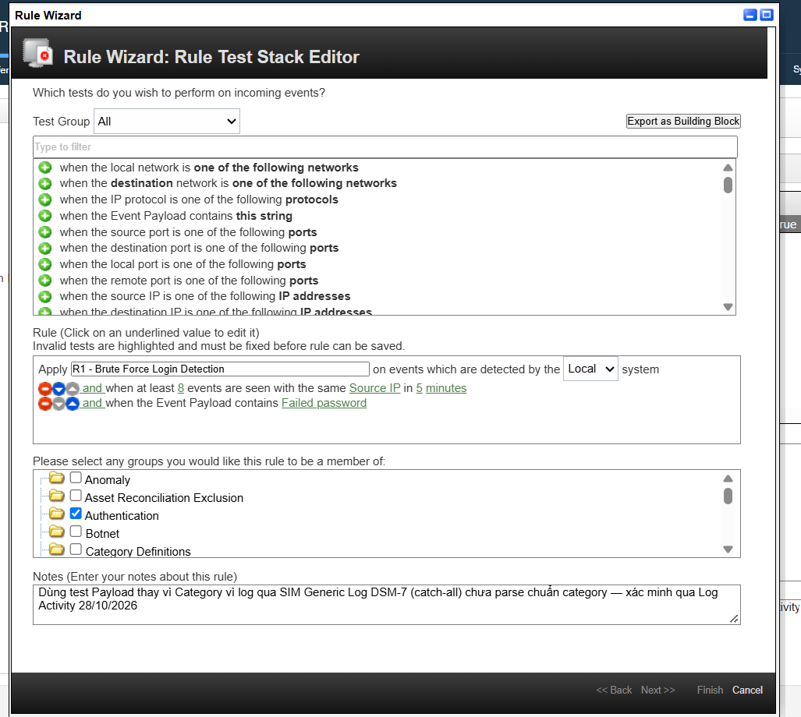
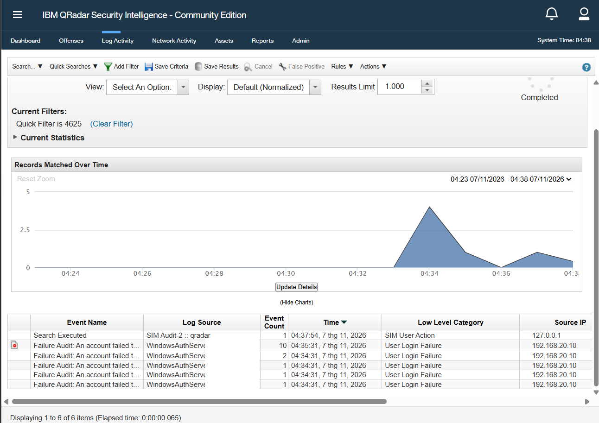
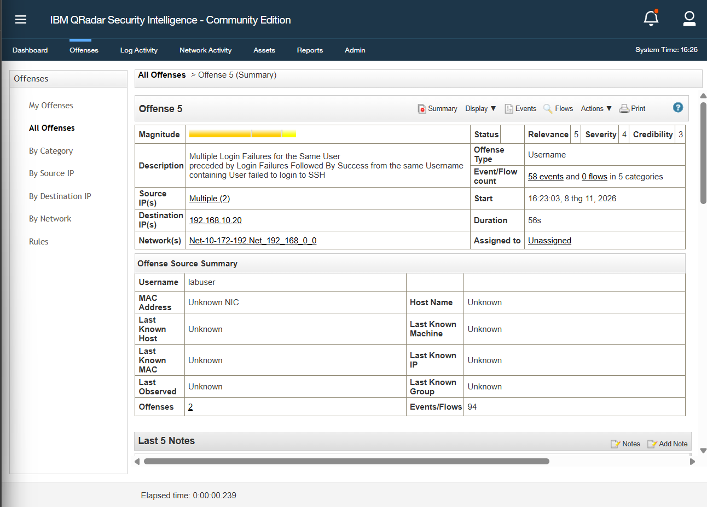

# Screenshots

These screenshots document the isolated lab topology and representative QRadar
detection results.

## Lab architecture

## QRadar detection evidence

### SSH brute-force rule

The rule triggers after at least eight events from the same source IP within
five minutes when the event payload contains `Failed password`.

### Windows authentication failures

The workstation hostname has been redacted.

### SSH brute-force offense

The offense summarizes repeated SSH login failures followed by a successful
login in the lab.

Before publishing additional screenshots, remove or redact credentials,
personal information, internal hostnames, and any other data that should not be
public.
